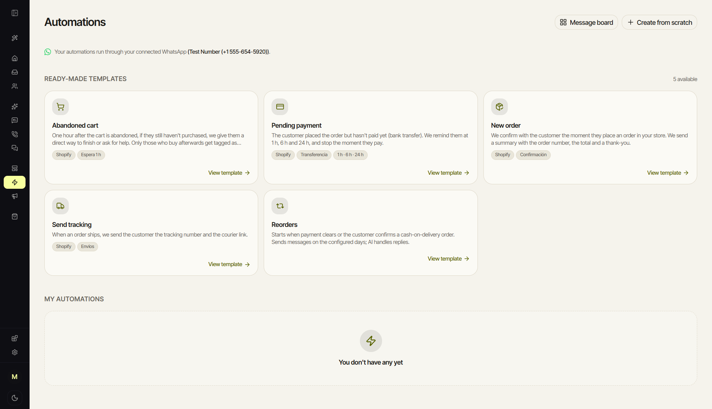
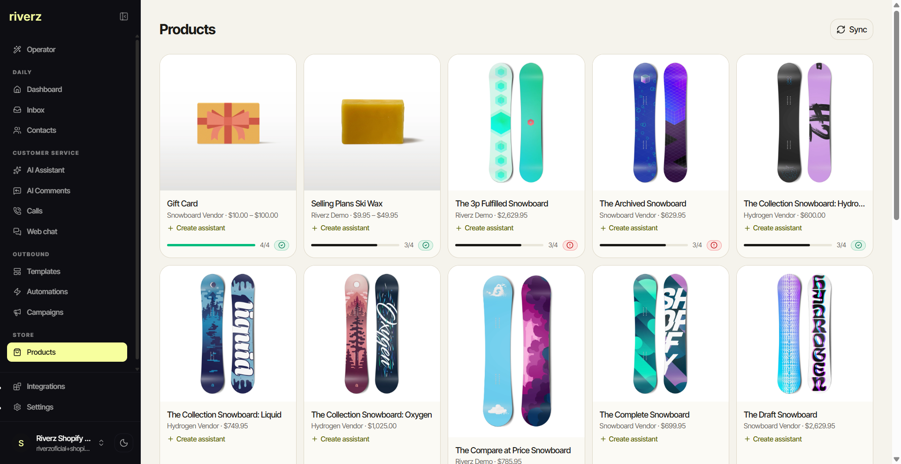
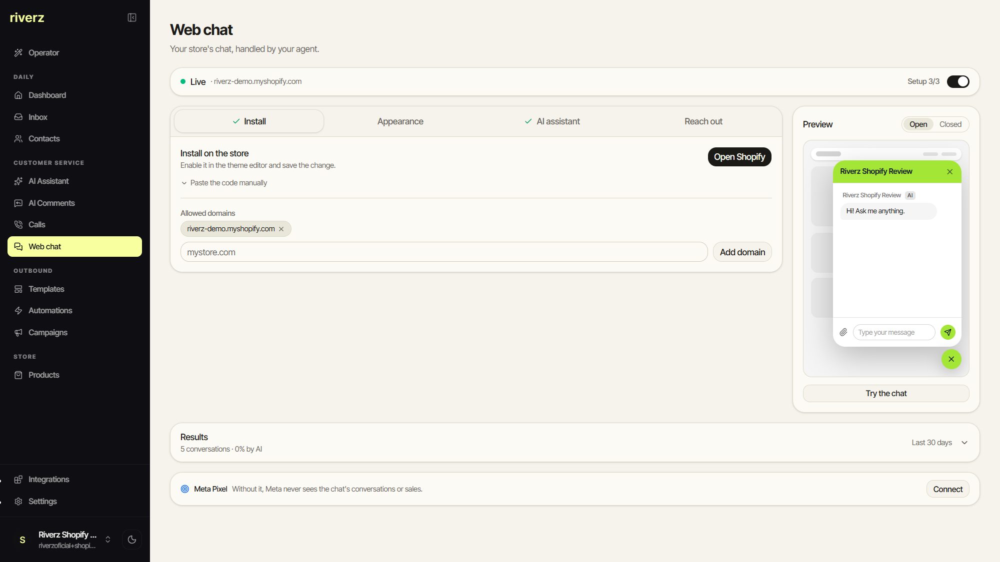
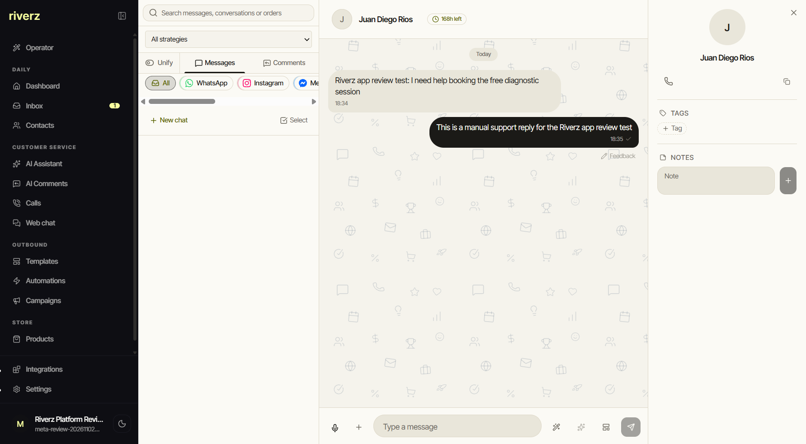
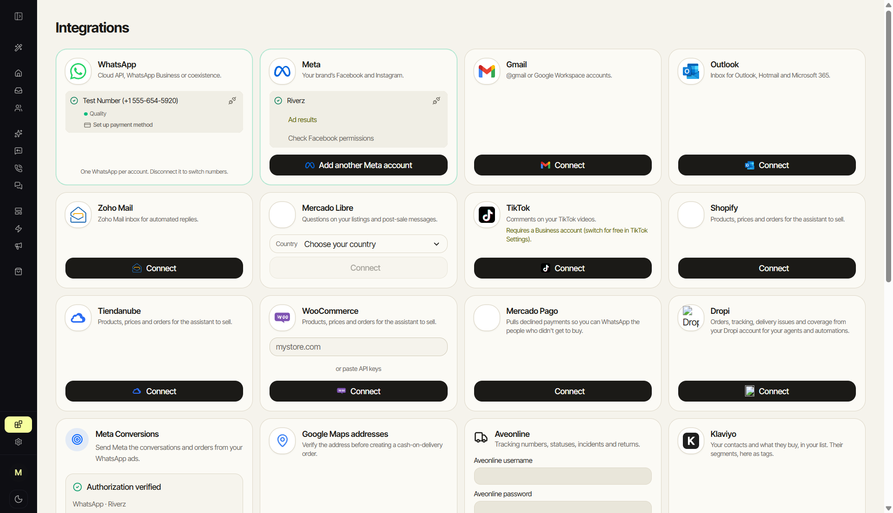
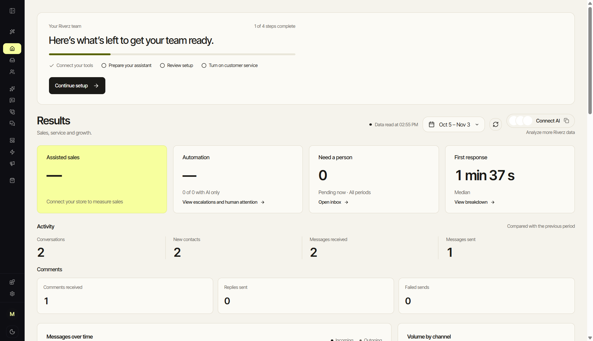

# Feature tour

The tour follows the catalog, channels and merchant setup. Shared CRM foundations remain credited to wacrm.

[Overview](README.md) · [Capture provenance](SCREENSHOTS.md)

[Commerce](#commerce) · [Channels and people](#channels-and-people) · [Connections](#connections) · [Merchant setup](#merchant-setup)

## Commerce

### Commerce automations

Browse cart-recovery, payment-reminder, order-confirmation, tracking and reorder templates.

*November 3, 2026 review workspace; English/light. No automation was created or sent for the capture.*

### Connected product catalog

Review product cards from the connected Shopify development store.

*November 3, 2026 platform-review workspace; English/light with development-store sample products.*

## Channels and people

### Storefront web chat

Configure widget appearance and installation, then inspect the native chat preview.

*November 3, 2026 review workspace; English/light. The preview is not a live customer conversation.*

### Shared inbox and contact context

Read a conversation alongside the contact profile, tags and notes.

*November 2, 2026 app-review test; English/light. The messages explicitly identify a manual support test with the account owner.*

## Connections

### Channel and commerce connections

Inspect the available channel/store connectors and workspace-specific connection state.

*November 3, 2026 review workspace; English/light with a WhatsApp test-number connection.*

## Merchant setup

### Merchant onboarding dashboard

Review workspace setup and the dashboard entry point.

*November 3, 2026 review workspace; English/light. Dashboard observations are not merchant performance metrics.*

## Coverage and implementation notes

| Area | Coverage boundary |
| --- | --- |
| Product knowledge, media readiness and merchant-specific AI assistance | The catalog is pictured; a completed AI sales conversation and all readiness controls are not pictured. |
| Inbox, contacts, automations and campaigns | Inbox/contact context and automation templates are pictured. Their shared foundation comes from [wacrm](https://github.com/ArnasDon/wacrm). Campaign sends and pipeline outcomes are not pictured. |
| Store orders, logistics, returns and human handoff | Implementation is described in [Capabilities](CAPABILITIES.md) and [Engineering](ENGINEERING.md); no private order or operational receipt is published. |
| Dealers and Ventas adaptations | They remain adaptations of this product in [Variants](VARIANTS.md); no duplicate product case or separate capture set is claimed. |

[Back to overview](README.md)
