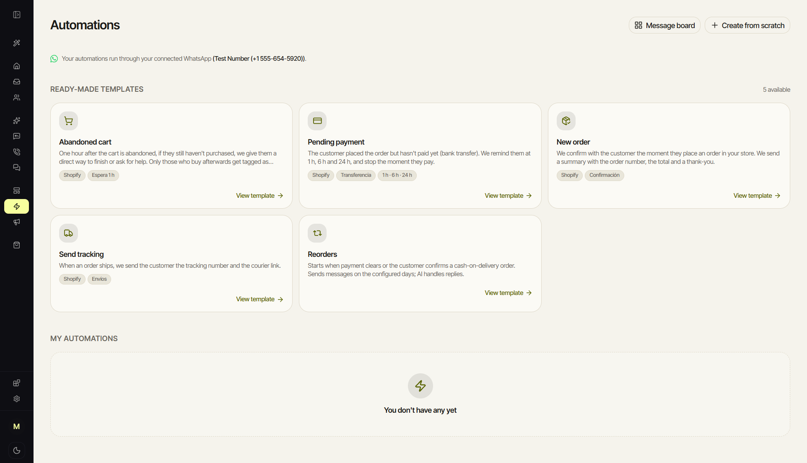
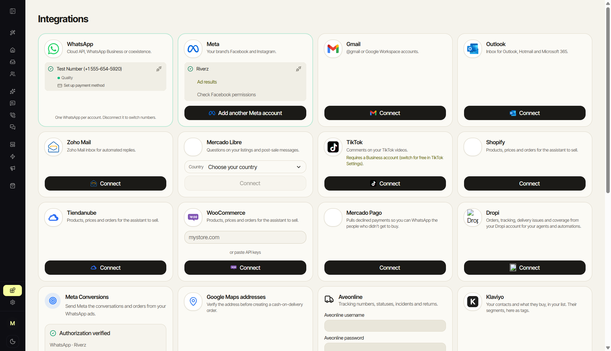

# Riverz CRM

**WhatsApp commerce workflows with merchant-specific AI assistance.**

[Product map](CAPABILITIES.md) · [Engineering](ENGINEERING.md) · [CRM adaptations](VARIANTS.md) · [wacrm foundation](https://github.com/ArnasDon/wacrm) · [Contact](https://github.com/excelenciaempire/riverz-showcase/issues/new?title=Professional%20inquiry)

Riverz CRM connects customer conversations with the merchant's products, offers, images, delivery conditions and support policies.

## Commerce workflows

Actual application capture, November 3, 2026; native English/light review workspace. The catalog shows available templates; no automation was created or sent for the capture.

Connections and review-workspace dashboard

### Channel and commerce connections

Actual application capture, November 3, 2026; native English/light interface with a test-number connection. Visible connections are specific to that review workspace.

### Dashboard

Actual application capture, November 3, 2026; English/light interface. These are review-workspace observations, not a merchant performance claim.

[Capture provenance](SCREENSHOTS.md)

## My contribution

I extend the open-source **wacrm** foundation by Arnas Donauskas with merchant-specific assistant behavior, product knowledge and media handling, onboarding, integration recovery and human handoff. The original inbox, contacts, pipelines, campaigns and automation foundation belong to wacrm.

The commerce work covers product questions, quantity and offer context, customer support, explicit order intent and requests for human assistance. Business facts remain scoped to the merchant.

## A technical decision

A conversation needs validation across multiple turns: keeping the selected product, answering from the current offer and respecting human intervention. An uncertain message-send result also needs reconciliation before retrying. [Read the decisions](ENGINEERING.md).

**TypeScript · React · Next.js · Supabase/PostgreSQL · WhatsApp Business API**

**All my development work presented here was done with AI assistance.** I use programming and software engineering fundamentals to define requirements, review code, test behavior and take responsibility for technical decisions.

This is a documentation case study. Application source, merchant configuration and customer conversations stay private.
