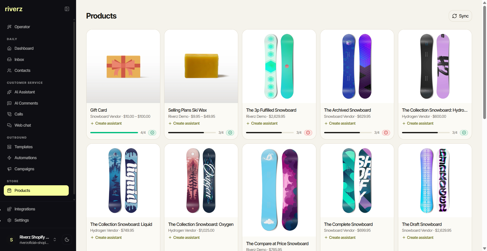
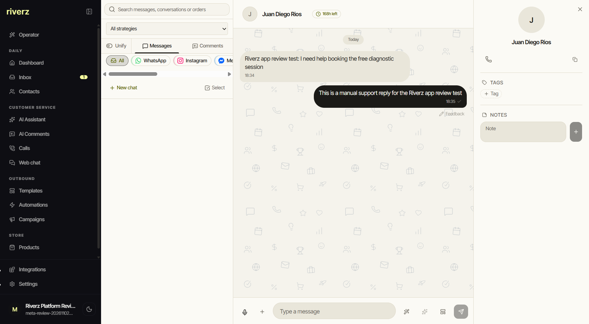

# Riverz CRM

**WhatsApp commerce workflows with merchant-specific AI assistance.**

[Feature tour](FEATURES.md) · [Product map](CAPABILITIES.md) · [Engineering](ENGINEERING.md) · [CRM adaptations](VARIANTS.md) · [wacrm foundation](https://github.com/ArnasDon/wacrm) · [Contact](https://github.com/excelenciaempire/riverz-showcase/issues/new?title=Professional%20inquiry)

Riverz CRM connects customer conversations with the merchant's products, offers, images, delivery conditions and support policies.

## Commerce workflows

### Commerce automations

Browse cart-recovery, payment-reminder, order-confirmation, tracking and reorder templates.

*November 3, 2026 review workspace; English/light. No automation was created or sent for the capture.*

### Connected product catalog

Review product cards from the connected Shopify development store.

*November 3, 2026 platform-review workspace; English/light with development-store sample products.*

### Shared inbox and contact context

Read a conversation alongside the contact profile, tags and notes.

*November 2, 2026 app-review test; English/light. The messages explicitly identify a manual support test with the account owner.*

[See the six-view tour: products, inbox, web chat, automations, integrations and setup](FEATURES.md).

## My contribution

I extend the open-source **wacrm** foundation by Arnas Donauskas with merchant-specific assistant behavior, product knowledge and media handling, onboarding, integration recovery and human handoff. The original inbox, contacts, pipelines, campaigns and automation foundation belong to wacrm.

The commerce work covers product questions, quantity and offer context, customer support, explicit order intent and requests for human assistance. Business facts remain scoped to the merchant.

## A technical decision

A conversation needs validation across multiple turns: keeping the selected product, answering from the current offer and respecting human intervention. An uncertain message-send result also needs reconciliation before retrying. [Read the decisions](ENGINEERING.md).

**TypeScript · React · Next.js · Supabase/PostgreSQL · WhatsApp Business API**

**All my development work presented here was done with AI assistance.** I use programming and software engineering fundamentals to define requirements, review code, test behavior and take responsibility for technical decisions.

This is a documentation case study. Application source, merchant configuration and customer conversations stay private.
